# KUMPULAN KODE DIAGRAM DAN FLOWCHART UNTUK DRAW.IO (MERMAID)

File ini memuat seluruh kode diagram yang ada pada Laporan Magang **SIP-PERFORMA**. Kode di bawah menggunakan format **Mermaid**, yaitu format diagram teks yang didukung secara resmi dan langsung oleh **draw.io** (app.diagrams.net).

---

## CARA MEMASUKKAN KODE KE DRAW.IO:
1. Buka browser dan kunjungi **[draw.io](https://app.diagrams.net)** (atau buka aplikasi desktop Draw.io).
2. Buat dokumen baru (*Create New Diagram* &rarr; *Blank Diagram*).
3. Di bilah menu atas, klik: **Arrange** &rarr; **Insert** &rarr; **Advanced** &rarr; **Mermaid**  
   *(Atau klik tanda **`+`** pada toolbar &rarr; **Advanced** &rarr; **Mermaid**)*.
4. Salin (*copy*) kode diagram yang diinginkan dari file ini, lalu tempel (*paste*) ke dalam kotak Mermaid yang muncul.
5. Klik tombol **Insert**.
6. Diagram akan langsung terbentang otomatis dalam bentuk kotak-kotak dan panah rapi yang dapat Anda geser, ubah warna, atau ekspor menjadi gambar (**File &rarr; Export as &rarr; PNG / JPEG**) untuk dimasukkan ke Microsoft Word!

---

## DAFTAR DIAGRAM

### 1. Gambar 1.1 Bagan Struktur Organisasi Disperindag Kota Gorontalo
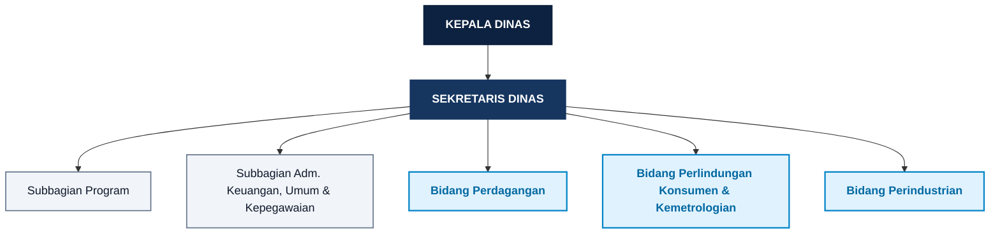

---

### 2. Gambar 2.3 Arsitektur Jaringan dan SI/TI Berjalan pada Disperindag
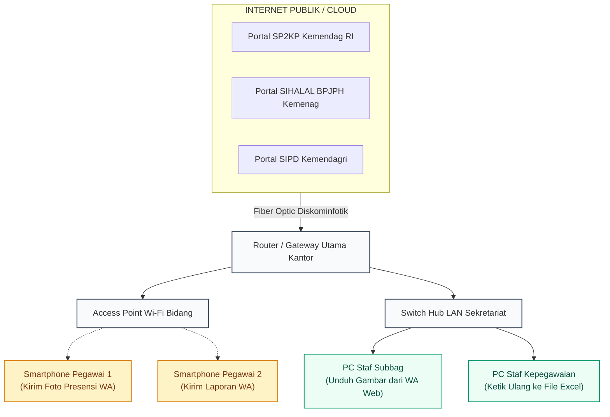

---

### 3. Gambar 2.4 Cross-Functional Flowchart (CFF) Alur Presensi & Evaluasi Berjalan (Manual)
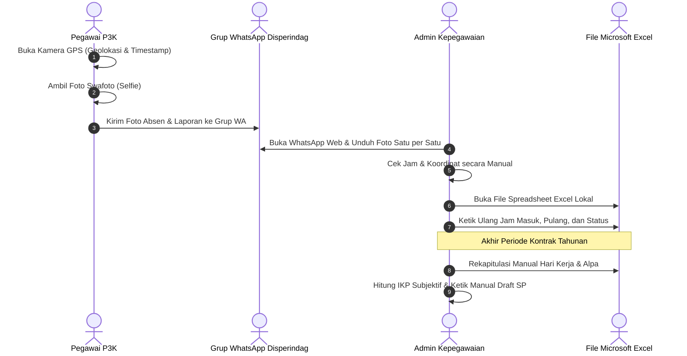

---

### 4. Gambar 3.1 Flowchart Proses Bisnis Usulan Sistem SIP-PERFORMA
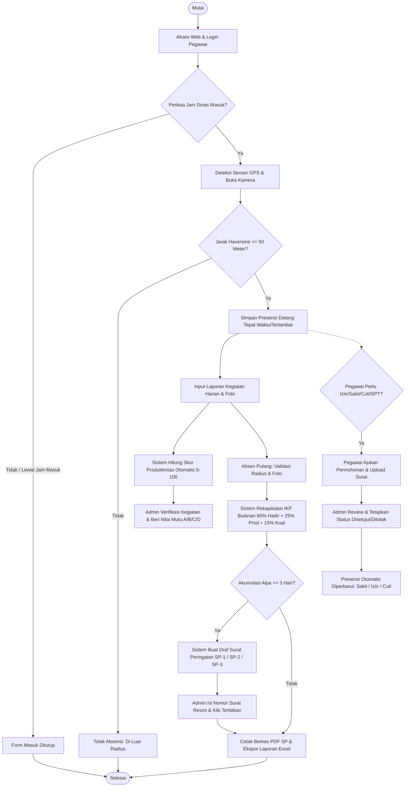

---

### 4B. Alternatif Gambar 3.1: Flowchart Lintas Fungsi 3 User / 3 Kolom (Swimlane)
*(Persis seperti format contoh: Kolom Pegawai P3K, Kolom Admin Kepegawaian, dan Kolom Pimpinan/Kepala Dinas)*

```mermaid
flowchart TD
    %% ==========================================
    %% KOLOM 1: PEGAWAI P3K
    %% ==========================================
    subgraph S1["1. Pegawai P3K"]
        P_START([Mulai])
        P_LOGIN[Halaman Login]
        P_INPUT_LOGIN[/Input NIP dan Password/]
        P_VALID_LOGIN{Kredensial<br/>Valid?}
        P_DASH[Halaman Dashboard Pegawai]
        P_PILIH{Pilih Jenis<br/>Aktivitas}
        
        %% Cabang Absensi
        P_CAM[Deteksi Sensor GPS & Kamera]
        P_VALID_RAD{Jarak <= 50m<br/>& Jam Sesuai?}
        P_TOLAK_RAD[Notifikasi di Luar Radius]
        P_DB_PRES[(Database<br/>Presensi)]
        
        %% Cabang Kegiatan
        P_INPUT_KEG[/Input Rincian Kegiatan & Foto/]
        P_AUTO_PROD[Hitung Skor Produktivitas Otomatis]
        P_DB_KEG[(Database<br/>Kegiatan)]
        P_NOTIF_KEG[Kirim Notifikasi Laporan ke Admin]
        
        %% Cabang Dispensasi
        P_INPUT_IZIN[/Input Izin / Sakit / Cuti & Upload Berkas/]
        P_DB_IZIN[(Database<br/>Pengajuan)]
        P_NOTIF_IZIN[Kirim Notifikasi Pengajuan ke Admin]

        P_LIHAT_IKP[Melihat Rekap IKP & Berkas SP Pribadi]
        P_END([Selesai])
    end

    %% ==========================================
    %% KOLOM 2: ADMIN KEPEGAWAIAN
    %% ==========================================
    subgraph S2["2. Admin Kepegawaian"]
        A_DASH[Halaman Dashboard Admin]
        
        %% Verifikasi Kegiatan
        A_VERIF_KEG{Verifikasi<br/>Kegiatan?}
        A_NILAI_MUTU[/Input Nilai Mutu A / B / C / D/]
        A_STATUS_KEG[(Status Verifikasi<br/>Disetujui)]
        
        %% Persetujuan Pengajuan
        A_REVIEW_IZIN{Tinjau Bukti<br/>Surat / SPT?}
        A_STATUS_IZIN[(Status Disetujui<br/>/ Ditolak)]
        A_SYNC_PRES[Sinkronisasi Presensi: Sakit / Izin / Cuti]
        
        %% Evaluasi IKP & SP
        A_REKAP_IKP[Kalkulasi IKP: Hadir 60% + Prod 25% + Kual 15%]
        A_DB_IKP[(Database<br/>Skor Kinerja)]
        A_CHECK_ALPA{Akumulasi<br/>Alpa >= 3 Hari?}
        A_GEN_SP[Sistem Generate Draf Otomatis SP-1 / SP-2 / SP-3]
        A_INPUT_SP[/Input Nomor Surat Resmi/]
        A_DB_SP[(Database<br/>Surat Peringatan)]
        A_NOTIF_PIM[Kirim Rekap IKP & Draf SP ke Pimpinan]
    end

    %% ==========================================
    %% KOLOM 3: PIMPINAN (KEPALA DINAS)
    %% ==========================================
    subgraph S3["3. Pimpinan (Kepala Dinas / Sekretaris)"]
        L_DASH[Halaman Dashboard Pimpinan]
        L_REVIEW_IKP[Tinjau Evaluasi Kinerja Bulanan SKPD]
        L_EVAL_KONTRAK{Evaluasi<br/>Perpanjangan<br/>Kontrak?}
        L_STATUS_KONTRAK[(Rekomendasi<br/>Kontrak Kerja)]
        L_SIGN_SP[Pengesahan & Tanda Tangan Dokumen Surat Peringatan]
        L_SELESAI([Selesai])
    end

    %% ==========================================
    %% HUBUNGAN & ALIRAN DATA ANTAR ELEMEN
    %% ==========================================
    P_START --> P_LOGIN
    P_LOGIN --> P_INPUT_LOGIN
    P_INPUT_LOGIN --> P_VALID_LOGIN
    P_VALID_LOGIN -- no --> P_INPUT_LOGIN
    P_VALID_LOGIN -- yes --> P_DASH
    P_DASH --> P_PILIH
    
    %% Alur Presensi
    P_PILIH --> P_CAM
    P_CAM --> P_VALID_RAD
    P_VALID_RAD -- no --> P_TOLAK_RAD
    P_TOLAK_RAD --> P_END
    P_VALID_RAD -- yes --> P_DB_PRES
    
    %% Alur Kegiatan
    P_PILIH --> P_INPUT_KEG
    P_INPUT_KEG --> P_AUTO_PROD
    P_AUTO_PROD --> P_DB_KEG
    P_DB_KEG --> P_NOTIF_KEG
    P_NOTIF_KEG --> A_DASH
    A_DASH --> A_VERIF_KEG
    A_VERIF_KEG -- no --> P_INPUT_KEG
    A_VERIF_KEG -- yes --> A_NILAI_MUTU
    A_NILAI_MUTU --> A_STATUS_KEG
    A_STATUS_KEG --> A_REKAP_IKP
    
    %% Alur Dispensasi
    P_PILIH --> P_INPUT_IZIN
    P_INPUT_IZIN --> P_DB_IZIN
    P_DB_IZIN --> P_NOTIF_IZIN
    P_NOTIF_IZIN --> A_DASH
    A_DASH --> A_REVIEW_IZIN
    A_REVIEW_IZIN -- no --> A_STATUS_IZIN
    A_REVIEW_IZIN -- yes --> A_SYNC_PRES
    A_SYNC_PRES --> A_STATUS_IZIN
    A_STATUS_IZIN --> P_DB_PRES
    
    %% Alur IKP & SP
    P_DB_PRES --> A_REKAP_IKP
    A_REKAP_IKP --> A_DB_IKP
    A_DB_IKP --> A_CHECK_ALPA
    A_CHECK_ALPA -- no --> A_NOTIF_PIM
    A_CHECK_ALPA -- yes --> A_GEN_SP
    A_GEN_SP --> A_INPUT_SP
    A_INPUT_SP --> A_DB_SP
    A_DB_SP --> A_NOTIF_PIM
    
    %% Alur ke Pimpinan
    A_NOTIF_PIM --> L_DASH
    L_DASH --> L_REVIEW_IKP
    L_REVIEW_IKP --> L_EVAL_KONTRAK
    L_EVAL_KONTRAK --> L_STATUS_KONTRAK
    L_STATUS_KONTRAK --> L_SIGN_SP
    L_SIGN_SP --> P_LIHAT_IKP
    L_SIGN_SP --> L_SELESAI
    P_LIHAT_IKP --> P_END

---

### 5. Gambar 3.2 Diagram Konteks Sistem SIP-PERFORMA
```mermaid
flowchart TD
    ADM["ADMINISTRATOR<br/>(Subbag Kepegawaian)"]
    PEG["PEGAWAI P3K<br/>(Aparatur Dinas)"]
    SYS(("SISTEM INFORMASI<br/>SIP-PERFORMA<br/>(PROSES 0)"))
    PIM["PIMPINAN<br/>(Kepala Dinas)"]

    %% Interaksi Pegawai
    PEG -- "1. Koordinat GPS & Swafoto Masuk/Pulang<br/>2. Laporan Kegiatan & Foto Bukti<br/>3. Permohonan Izin / Sakit / Cuti / SPT" --> SYS
    SYS -- "1. Status Validasi Radius & Presensi<br/>2. Rincian Skor Kinerja (IKP) Mandiri<br/>3. Berkas Surat Peringatan (PDF)" --> PEG

    %% Interaksi Admin
    ADM -- "1. Data Master Pegawai & Akun<br/>2. Verifikasi & Nilai Mutu Kegiatan<br/>3. Persetujuan Dispensasi (Izin/Sakit/Cuti)<br/>4. Nomor & Penerbitan SP<br/>5. Parameter Lokasi, Jam & Bobot IKP" --> SYS
    SYS -- "1. Rekapitulasi Presensi Seluruh Pegawai<br/>2. Peringatan Draf SP Otomatis<br/>3. Berkas Laporan Excel & PDF" --> ADM

    %% Interaksi Pimpinan
    SYS -- "1. Laporan Eksekutif Disiplin Bulanan<br/>2. Rekomendasi Kelayakan Kontrak Kerja" --> PIM

    classDef user fill:#E0F2FE,stroke:#0284C7,stroke-width:2px,color:#0369A1,font-weight:bold;
    classDef sys fill:#0D2240,stroke:#0D2240,stroke-width:2.5px,color:#FFFFFF,font-weight:bold;
    class ADM,PEG,PIM user;
    class SYS sys;
```

---

### 6. Gambar 3.3 Hierarchy Chart (Dekomposisi Fungsional Sistem)
```mermaid
graph TD
    ROOT["0.0 SISTEM INFORMASI SIP-PERFORMA"]
    
    ROOT --> M1["1.0 Modul Data & Pengguna"]
    ROOT --> M2["2.0 Modul Presensi & Dispensasi"]
    ROOT --> M3["3.0 Modul Kegiatan Harian"]
    ROOT --> M4["4.0 Modul Evaluasi & Pelaporan"]

    M1 --> M11["1.1 Kelola Master Data Pegawai"]
    M1 --> M12["1.2 Kelola Akun & Reset Password"]
    M1 --> M13["1.3 Pengaturan Parameter Kantor"]

    M2 --> M21["2.1 Absensi Datang & Pulang Geofence"]
    M2 --> M22["2.2 Riwayat Presensi Pegawai"]
    M2 --> M23["2.3 Pengajuan Izin, Cuti, Sakit, Dinas"]
    M2 --> M24["2.4 Persetujuan Dispensasi Admin"]

    M3 --> M31["3.1 Input Laporan Kegiatan & Foto"]
    M3 --> M32["3.2 Hitung Skor Produktivitas Otomatis"]
    M3 --> M33["3.3 Verifikasi & Penilaian Mutu Atasan"]

    M4 --> M41["4.1 Kalkulasi Indeks Kinerja Pegawai (IKP)"]
    M4 --> M42["4.2 Deteksi Ambang & Draf SP Otomatis"]
    M4 --> M43["4.3 Penerbitan & Cetak PDF SP"]
    M4 --> M44["4.4 Ekspor Rekapitulasi Excel & PDF"]

    classDef main fill:#0D2240,stroke:#0D2240,color:#fff,font-weight:bold;
    classDef mod fill:#1E40AF,stroke:#1E40AF,color:#fff,font-weight:bold;
    classDef sub fill:#F8FAFC,stroke:#64748B,color:#0F172A;

    class ROOT main;
    class M1,M2,M3,M4 mod;
    class M11,M12,M13,M21,M22,M23,M24,M31,M32,M33,M41,M42,M43,M44 sub;
```

---

### 7. Gambar 3.4 Data Flow Diagram (DFD) Level 0
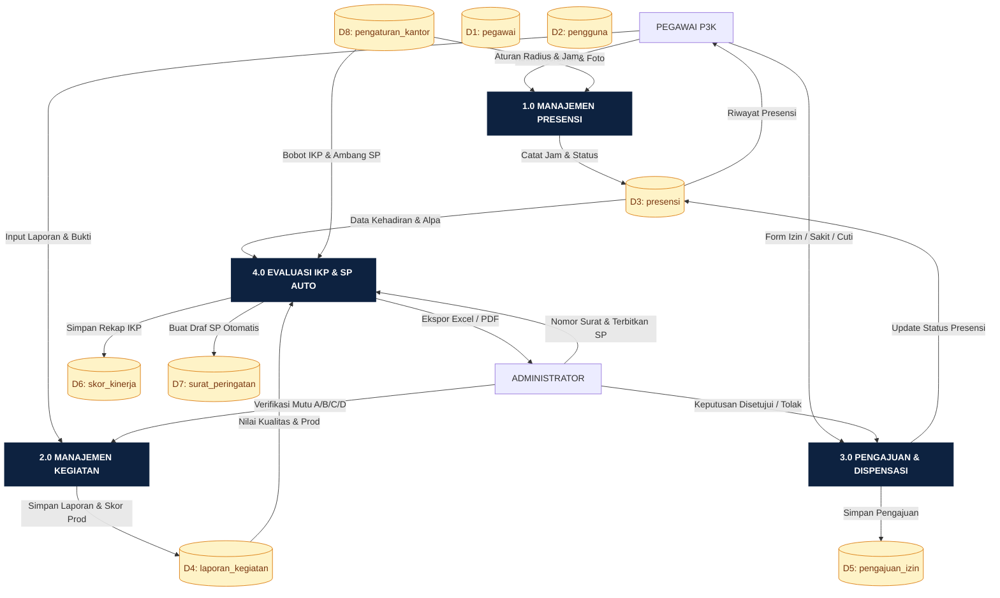

---

### 8. Gambar 3.5 DFD Level 1 Proses 1.0 (Manajemen Presensi)
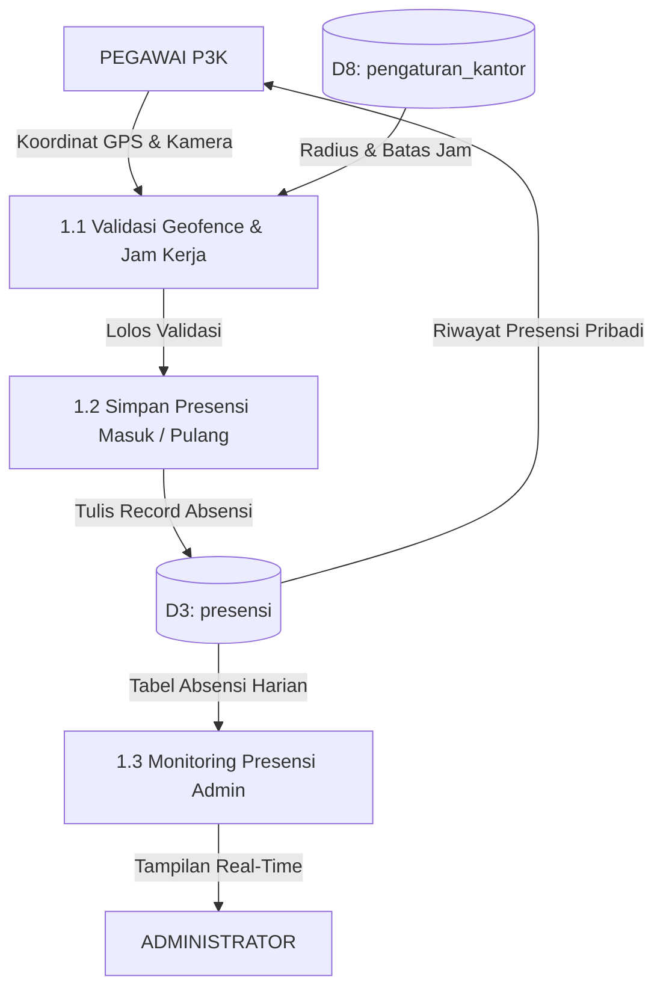

---

### 9. Gambar 3.6 DFD Level 1 Proses 2.0 (Manajemen Laporan Kegiatan)
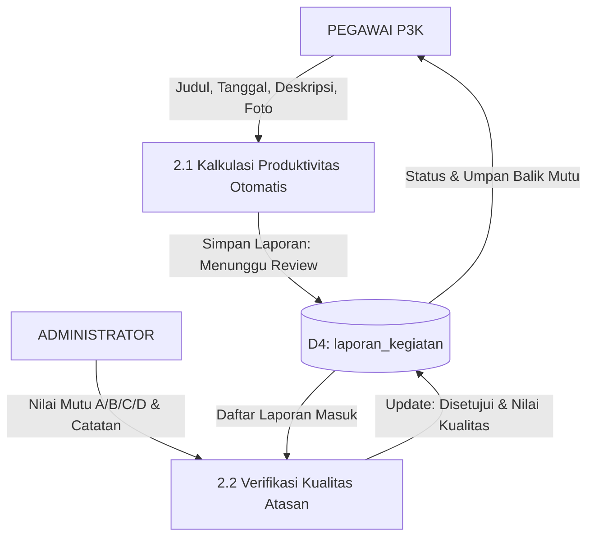

---

### 10. Gambar 3.7 DFD Level 1 Proses 3.0 (Manajemen Pengajuan & Dispensasi)
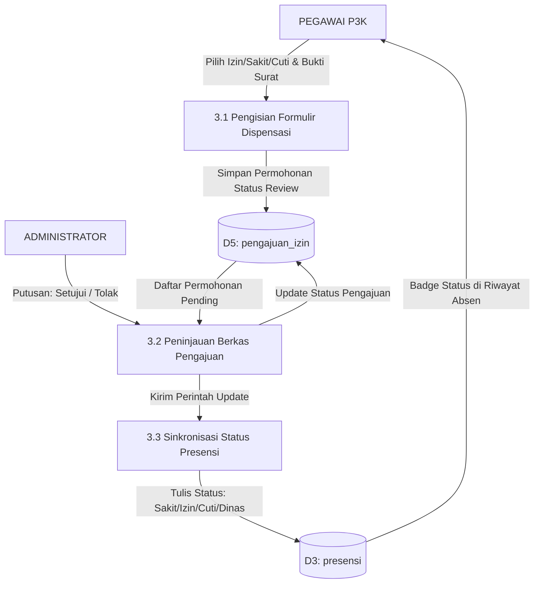

---

### 11. Gambar 3.8 DFD Level 1 Proses 4.0 (Perhitungan Kinerja & Penerbitan SP)
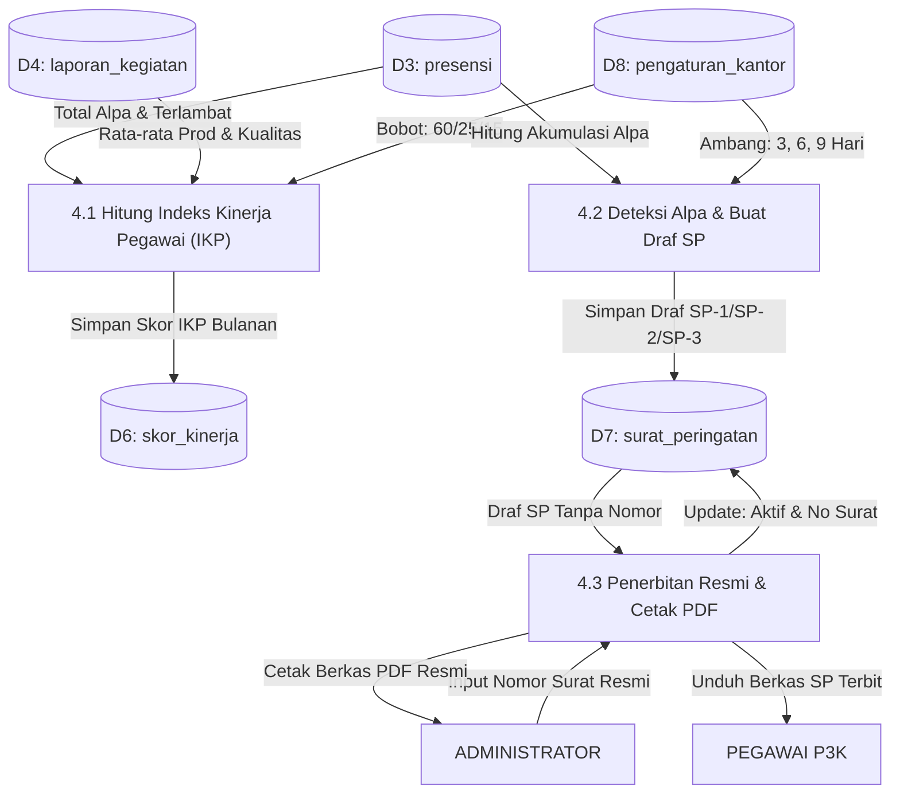

---

### 12. Gambar 3.9 Entity Relationship Diagram (ERD) Sistem SIP-PERFORMA
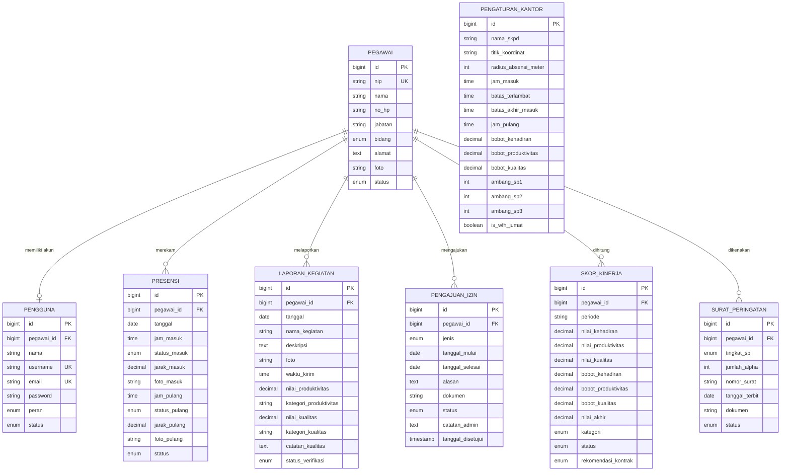

---

### 13. Gambar 3.10 Arsitektur Software Model-View-Controller (MVC) Laravel
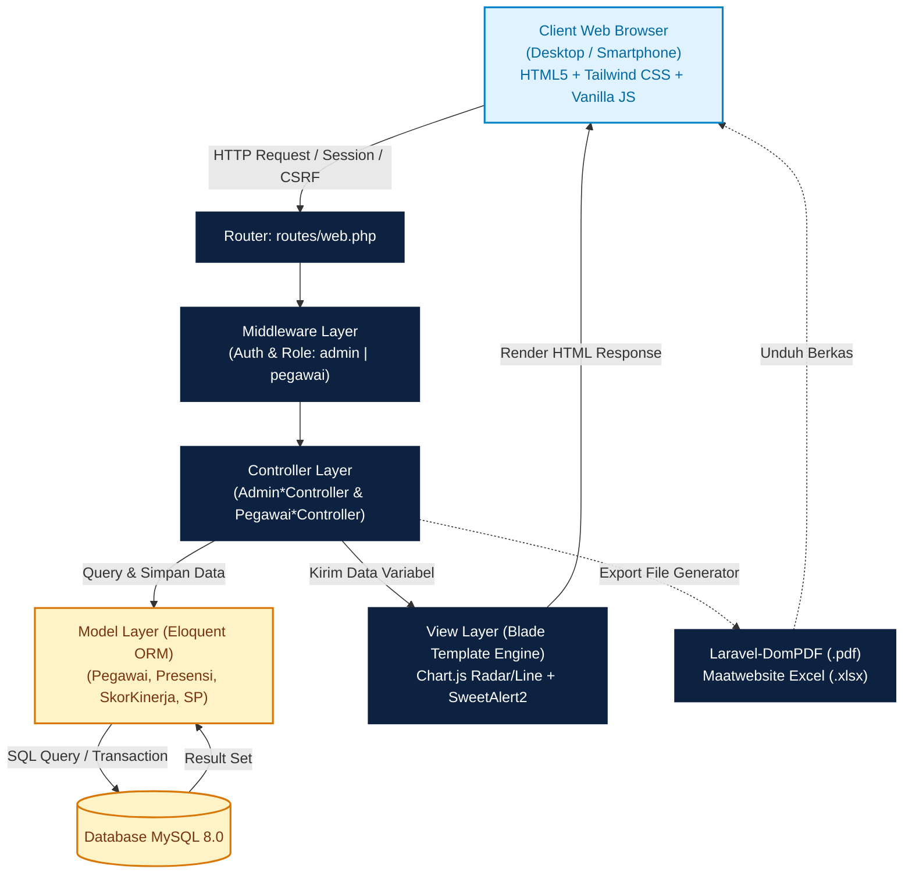
